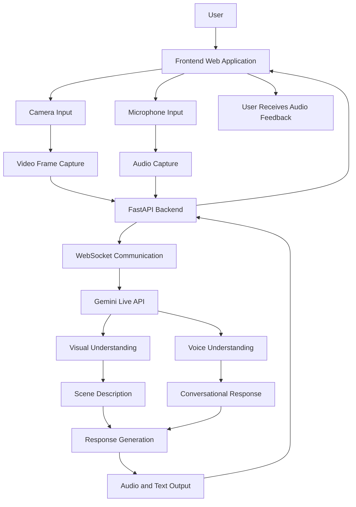

# IRIS – Integrated Real-Time Interpretive System

**An AI-powered visual assistance system designed to help visually impaired individuals understand their surroundings through real-time environmental interpretation and voice interaction.**

## 1. Introduction

IRIS (Integrated Real-Time Interpretive System) is an AI-powered visual assistance application that aims to help visually impaired individuals interpret and understand their surroundings.

The system uses a device's camera to capture real-time visual information and Google's Gemini Live API to analyse the environment, identify objects, understand scenes, and generate contextual descriptions through voice-based interaction.

Unlike traditional voice assistants that primarily respond to user commands, IRIS aims to provide proactive environmental awareness by detecting relevant changes in the surroundings and communicating useful information to the user through audio feedback.

## 2. Problem Statement

Visually impaired individuals often face challenges in understanding their immediate surroundings, identifying objects, recognizing obstacles, and navigating unfamiliar environments.

Existing assistive solutions may provide limited environmental context or require continuous human assistance.

There is a need for an intelligent, accessible, and real-time assistance system that can interpret visual surroundings and communicate meaningful information through audio.

IRIS aims to address this problem using artificial intelligence, computer vision, and natural voice interaction to improve environmental awareness and accessibility.

## 3. Objectives

- Develop an AI-powered visual assistance system for visually impaired individuals.
- Capture and analyse real-time environmental information through a device camera.
- Identify and describe objects, people, and surrounding scenes.
- Enable natural voice-based interaction between users and the AI assistant.
- Provide contextual audio descriptions and environmental alerts.
- Detect relevant changes in surroundings and communicate them proactively.
- Improve accessibility and support independent environmental awareness.

## 4. Technology Stack

| Component | Technology | Purpose |
|---|---|---|
| Frontend | HTML5 | Application structure |
| Styling | CSS3 | Interface styling |
| UI Framework | Bootstrap 5 | Responsive user interface |
| Frontend Logic | JavaScript | Camera, microphone and user interaction |
| Backend Language | Python | Application logic and processing |
| Backend Framework | FastAPI | API development and request handling |
| ASGI Server | Uvicorn | Running the backend server |
| AI Model | Google Gemini Live API | Real-time multimodal understanding and AI interaction |
| AI Integration | Google GenAI SDK | Communication with Gemini |
| Real-Time Communication | WebSockets | Bidirectional data communication |
| Computer Vision | OpenCV | Image processing and scene change detection |
| Audio Processing | Web Audio API | Audio input and playback |
| Configuration | Python dotenv | Environment variable management |
| Version Control | Git and GitHub | Source code management |

## 5. System Architecture

IRIS follows a client-server architecture where the frontend handles user interaction and device input, the FastAPI backend manages application logic and communication, and Gemini Live API performs AI-powered visual and conversational processing.

### Architecture Diagram

### Architecture Components

**1. Frontend Layer**
- Provides the user interface.
- Accesses the device camera and microphone.
- Captures video frames and audio input.
- Displays AI-generated descriptions.
- Plays audio responses.

**2. Backend Layer – FastAPI**
- Handles application requests and API endpoints.
- Manages WebSocket connections.
- Coordinates communication with Gemini Live API.
- Handles incoming and outgoing data.
- Manages API credentials securely.

**3. Computer Vision Layer – OpenCV**
- Supports image processing.
- Analyses captured frames.
- Detects relevant changes between consecutive frames.
- Supports environmental awareness features.

**4. AI Processing Layer – Gemini Live API**
- Analyses visual information.
- Understands user voice input.
- Generates contextual scene descriptions.
- Provides conversational responses.
- Supports multimodal real-time interaction.

**5. Audio Interaction Layer**
- Captures voice input from the user.
- Transfers audio for AI processing.
- Receives AI-generated audio responses.
- Delivers spoken feedback to the user.
